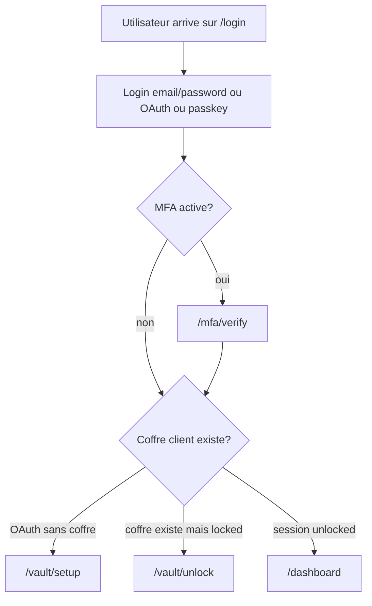

# 03 - Authentification, sessions et acces

## Objectif

NexusVault separe plusieurs notions qui sont souvent confondues:

- authentification du compte;
- verification email;
- MFA;
- deverrouillage du coffre;
- presence de la cle de coffre dans le navigateur.

Un utilisateur peut etre connecte sans avoir le coffre deverrouille. C'est une
decision centrale.

## Flux global



## Login classique

Fichiers:

```text
app/Http/Controllers/LoginController.php
app/Services/Auth/LoginService.php
app/Http/Requests/LoginEmailRequest.php
app/Http/Requests/LogUserRequest.php
```

Le login est separe en deux temps:

1. email;
2. password.

`LoginService`:

- retrouve l'utilisateur;
- verifie `Hash::check`, contre un hash jetable si le compte est inconnu, pour
  que le temps de reponse ne revele pas l'existence d'un compte;
- renvoie le meme message `Invalid credentials` pour un compte inconnu et un
  mauvais mot de passe;
- exige email verifie;
- etablit la session via `AuthenticatedSessionService`;
- redirige vers MFA, vault setup ou vault unlock.

Important: le login password n'est pas le vault password.

### Etablissement de session (`AuthenticatedSessionService`)

Tous les points d'entree qui connectent un utilisateur (login, OAuth, passkey,
inscription) passent par `app/Services/Auth/AuthenticatedSessionService.php`:

1. si la session appartient deja a un utilisateur, elle est invalidee en
   entier (`Auth::logout` + `Session::invalidate`);
2. sinon, les preuves par utilisateur sont purgees: `mfa_verified`,
   `vault_unlocked_at`, `masterKey`, `mfa_pending_secret`;
3. `Auth::login` puis `Session::regenerate`.

Une session qui a passe la MFA d'un compte ne peut donc jamais servir a
sauter la MFA d'un autre compte.

Les routes de login, d'inscription, OAuth et de login passkey portent le
middleware `guest`. Une session authentifiee qui les appelle est renvoyee vers
`/mfa/verify`, `/vault/setup` ou `/vault/unlock` (voir `bootstrap/app.php`,
`redirectUsersTo`). Pour changer de compte, il faut se deconnecter.

### Politique de mot de passe

Une seule politique, declaree dans `AppServiceProvider` via
`Password::defaults()`: 12 caracteres minimum, majuscules et minuscules,
chiffres et symboles. La verification HIBP (`uncompromised`) est ajoutee en
production. Inscription, reinitialisation et changement de mot de passe
utilisent toutes `Password::defaults()`.

## Inscription

Fichiers:

```text
app/Http/Controllers/RegisterController.php
app/Services/Auth/RegisterService.php
resources/ts/auth.ts
resources/ts/zero-knowledge.ts
```

Sequence:

1. `auth.ts` valide le formulaire HTML.
2. `auth.ts` appelle `/register/validate`.
3. Laravel valide les champs compte avec `RegisterUserRequest::accountRules()`.
4. Si OK, le navigateur cree le paquet de coffre avec WebCrypto.
5. Le navigateur affiche la recovery key.
6. Le formulaire final est soumis.
7. Laravel stocke:
   - password de login hashe;
   - public key;
   - private key chiffree;
   - vault key envelope;
   - recovery envelope;
   - `encrypted_master_key = null`.
8. Laravel envoie l'email de verification.

Pourquoi valider avant de generer la recovery key?

Si le formulaire est invalide, afficher une recovery key puis refuser
l'inscription cree une experience incoherente: l'utilisateur croit avoir une cle
pour un coffre qui n'existe pas. NexusVault evite cela.

## OAuth

Fichiers:

```text
app/Http/Controllers/OAuthController.php
app/Services/Auth/OAuthService.php
```

Providers:

- Google;
- GitHub.

Le flux utilise le `state` de Socialite (pas de `stateless()`): le callback
compare le `state` recu a celui pose en session a la redirection et renvoie
vers `/login` avec un message generique si l'un des deux manque ou differe.
Cette protection exige que le cookie de session survive a l'aller-retour vers
le fournisseur: `SESSION_SAME_SITE=lax` (valeur par defaut, `strict` casse le
flux), un `SESSION_DOMAIN` qui correspond a l'hote reel et un
`*_REDIRECT_URI` sur ce meme hote.

Nouveau user OAuth:

- password dummy random;
- `is_oauth=true`;
- email considere verifie;
- pas de coffre au depart;
- redirection vers `/vault/setup`.

Regle importante:

```php
public function requiresClientVaultSetup(): bool
{
    return $this->is_oauth && empty($this->vault_key_envelope);
}
```

Cela detruit l'ancienne voie "legacy OAuth vault unlock". Un OAuth user sans
enveloppe client doit creer un vrai coffre zero-knowledge.

## MFA TOTP

Fichiers:

```text
app/Http/Controllers/MfaController.php
app/Services/Auth/MfaService.php
resources/views/auth/mfa/setup.blade.php
```

Routes:

```text
GET  /mfa/setup
GET  /mfa/qr-code
POST /mfa/setup
GET  /mfa/verify
POST /mfa/verify
POST /mfa/disable
```

Le QR code est servi par `/mfa/qr-code` avec un `Content-Type: image/*`. Cela
evite de dependre d'un ``, qui peut etre casse par
certains contextes navigateur/headers.

Enrolement:

1. `GET /mfa/setup` genere un secret et le garde en session
   (`mfa_pending_secret`), pas en base;
2. `/mfa/qr-code` encode ce secret pendant;
3. `POST /mfa/setup` verifie le code contre le secret pendant; en cas de succes
   le secret est ecrit dans `users.totp_secret`, `mfa_enabled` passe a `true`,
   le secret pendant est retire de la session et `mfa_verified` est pose.

Les trois routes d'enrolement portent `auth` et `mfa`: une session qui n'a pas
encore passe la MFA ne peut pas re-enroler un autre authentificateur. Un
secret confirme n'est jamais re-affiche: `/mfa/setup` redirige vers les
reglages et `/mfa/qr-code` repond 404 quand `mfa_enabled` est vrai. Pour
changer d'authentificateur, il faut desactiver la MFA puis la reactiver.

Le secret TOTP confirme est stocke cote serveur dans `users.totp_secret`,
parce que le serveur doit pouvoir verifier le code. Cette partie n'est pas
zero-knowledge. La fenetre de tolerance est d'une periode de 30 secondes de
chaque cote (`MfaService::TOTP_WINDOW`).

### Re-authentification des actions destructrices

Trois actions exigent une preuve fraiche en plus de la session:

- suppression du compte (`DELETE /settings/account`);
- desactivation de la MFA (`POST /mfa/disable`);
- reinitialisation du coffre (`POST /vault/reset`).

Le formulaire envoie `current_password` (mot de passe de connexion, jamais le
mot de passe factice d'un compte OAuth) ou `totp_code` (code genere a
l'instant). `ReauthenticationService` verifie l'un ou l'autre, et le trait de
form request `ConfirmsFreshAuthentication` renvoie une seule erreur, sur
`current_password`, quel que soit le facteur en echec. Un compte OAuth sans
MFA ne dispose d'aucun facteur: il doit activer la MFA avant ces actions.

La suppression de compte ferme la session avant de supprimer la ligne: un
`Auth::logout` sur un modele deja supprime recyclerait le remember token et
reinsererait le compte.

## Passkeys WebAuthn

Fichiers:

```text
resources/ts/WebAuthn.ts
resources/ts/passkey.ts
app/Http/Controllers/WebAuthn/
config/webauthn.php
```

Routes:

```text
POST /webauthn/register/options
POST /webauthn/register
POST /webauthn/login/options
POST /webauthn/login
DELETE /webauthn/credentials/{credential}
```

Contraintes:

- l'enregistrement d'une passkey exige `auth`, `mfa`, `master_key`;
- la suppression d'une passkey verifie que la credential appartient bien a
  l'utilisateur courant;
- le login passkey redirige ensuite vers MFA ou vault unlock/setup.

## Verification email

Le modele `User` implemente `MustVerifyEmail`.

Fichiers:

```text
app/Notifications/EmailVerifier.php
resources/views/emails/email-verification.blade.php
```

En production, l'email passe par Resend. En local, on peut utiliser log ou
Mailpit selon `.env`.

## Sessions Laravel

Config actuelle:

```env
SESSION_DRIVER=database
SESSION_LIFETIME=120
SESSION_ENCRYPT=false
```

En production, les sessions sont stockees en base. Le cookie contient l'identifiant
de session et les protections Laravel habituelles.

Variables de session importantes:

- `mfa_verified`: l'utilisateur a passe MFA dans cette session;
- `vault_unlocked_at`: Laravel considere que le coffre est deverrouille pour les
  routes protegees;
- `mfa_pending_secret`: secret TOTP en cours d'enrolement, retire des que la
  MFA est confirmee;
- `masterKey`: ancien modele serveur, absent pour les utilisateurs modernes.

Ces quatre cles sont purgees a chaque nouveau login (voir
`AuthenticatedSessionService`).

Pour les utilisateurs zero-knowledge modernes, Laravel ne stocke pas la vault key.
Le navigateur stocke la vault key dans `sessionStorage`.

## Middleware `mfa`

Fichier:

```text
app/Http/Middleware/RequireMfa.php
```

Si l'utilisateur a `mfa_enabled=true` mais pas `mfa_verified`, il est redirige
vers `/mfa/verify`.

## Middleware `master_key`

Fichier:

```text
app/Http/Middleware/EnsureMasterKey.php
```

Ce middleware protege les routes sensibles.

Cas 1: OAuth sans coffre client:

- redirection vers `/vault/setup`;
- JSON: HTTP 428.

Cas 2: user moderne avec `vault_key_envelope`:

- si `vault_unlocked_at` existe: OK;
- sinon redirection vers `/vault/unlock`;
- JSON: HTTP 423.

Cas 3: user legacy sans client-side vault:

- essaie de recuperer `masterKey` en session;
- sinon redirection vers `/vault/unlock`.

## Unlock du coffre moderne

Fichiers:

```text
resources/views/auth/vault-unlock.blade.php
resources/ts/auth.ts
app/Http/Controllers/VaultUnlockController.php
```

Flux:

1. Blade expose `nexusVaultKeyEnvelope`.
2. L'utilisateur saisit le vault password.
3. TypeScript derive la wrapping key et decrypte la vault key.
4. TypeScript stocke la vault key dans `sessionStorage`.
5. TypeScript ajoute `client_unlocked=1`.
6. Laravel verifie seulement que ce flag existe.
7. Laravel stocke `vault_unlocked_at`.

Le serveur ne recoit pas le vault password.

## Recovery unlock

Flux:

1. Blade expose `vault_recovery_envelope`.
2. L'utilisateur saisit la recovery key.
3. TypeScript transforme la recovery key en bytes.
4. TypeScript decrypte la vault key.
5. Meme fin de flux que l'unlock normal.

## Logout et lock

Logout:

- supprime `masterKey` et `vault_unlocked_at`;
- `Auth::logout`;
- invalidate session;
- regenere token CSRF.

Lock:

- supprime `masterKey` et `vault_unlocked_at`;
- redirige vers `/vault/unlock`.

Limite: `clearStoredVaultKey()` existe cote TypeScript, mais le lock serveur doit
etre accompagne d'un nettoyage navigateur pour etre ideal. Voir `11-roadmap`.

## Matrice d'acces simplifiee

| Etat utilisateur | Route sensible | Resultat |
| --- | --- | --- |
| Non connecte | `/dashboard` | redirection login |
| Connecte | `/login`, `/register`, `/auth/*` | redirection vers l'etape suivante du login |
| Connecte, MFA active non verifiee | `/dashboard` | redirection `/mfa/verify` |
| Connecte, MFA active non verifiee | `/mfa/setup`, `/mfa/qr-code` | redirection `/mfa/verify` |
| Connecte, MFA confirmee | `/mfa/setup` | redirection `/settings`, secret jamais re-affiche |
| OAuth sans coffre | `/dashboard` | redirection `/vault/setup` |
| Coffre client locked | `/dashboard` | redirection `/vault/unlock` |
| Coffre client unlocked | `/dashboard` | autorise |
| User legacy sans `masterKey` | `/dashboard` | redirection `/vault/unlock` |

## Reinitialisation du mot de passe de connexion

`POST /reset-password` ne verifie pas l'existence de l'email dans les regles de
validation et renvoie le meme message (`passwords.token`) pour un email inconnu
et pour un jeton invalide. Un formulaire qui repond differemment confirmerait
quels comptes existent.

Limite connue: `/register/validate` et `/register` repondent encore
`email already taken` pour un email existant. Lever cette enumeration demande
un flux d'inscription par email (verification avant creation), prevu avec le
sprint identite.

## Ce que l'UI ne doit jamais etre seule a proteger

Exemple dangereux:

```blade
@if ($userCanDelete)
    <button>Delete</button>
@endif
```

Cela cache un bouton, mais ne protege pas la route. NexusVault verifie aussi:

- ownership dans `ServiceController`;
- permissions de partage dans `ShareService`;
- ownership passkey dans `SettingsController`;
- presence de `client_encrypted` dans les Form Requests.
